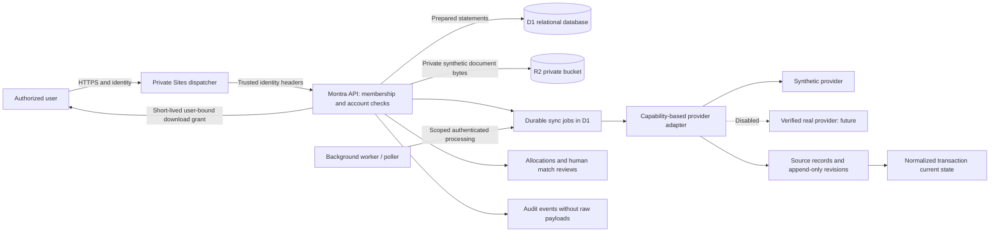

# Data flow and trust boundaries

Browser input is untrusted. IDs never substitute for authorization. Every business row carries organization scope; account-bearing records carry account scope. Raw transaction narration is rendered as text. Raw provider payloads stay in protected source revision storage and are never included in error telemetry.

Provider credentials must be resolved server-side through a secrets-manager adapter. No provider credential exists in this pilot. The incomplete real adapter throws before any network request. Scanning is a deployment integration point: real documents fail closed. Synthetic text invoices are visibly labelled and validated; a text-only demo upload does not imply a malware-free production service.

Transport security and managed encryption at rest depend on the hosting platform's verified configuration. These are deployment requirements, not claims of certification.

