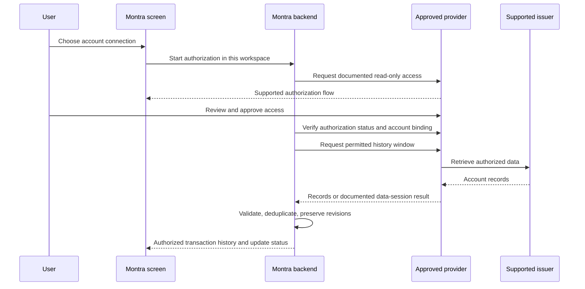

# SBI Card connection investigation

Reviewed: 15 October 2026. Product under investigation: SBI Cashback credit card (Mastercard variant). No personal account identifiers are needed or stored in this report.

## Decision

**Automated SBI Card transaction access is unconfirmed.** No reviewed official source establishes a permitted SBI Cashback transaction feed for Montra. This is not proof that every commercial route is unavailable. Do not implement guessed endpoints or treat SBI deposit-account coverage, Mastercard acceptance, tokenisation, or bill payments as transaction-history coverage.

| Candidate route | Verified evidence | SBI Card transaction coverage | Price / access decision |
|---|---|---|---|
| SBI Card customer website | Customers can download up to 24 months of PDF statements according to the issuer FAQ | Customer download verified; third-party API unconfirmed | No Montra API price or developer sandbox established |
| Finvu AA | Official AA sandbox documentation and published pricing models | Unconfirmed for SBI Cashback; request explicit issuer/product confirmation | Per-fetch range INR 0.20–2.50, or active-user/account range INR 3–6 per billing period; volume pricing bespoke. Setup, monthly minimum, sandbox fees, taxes and contract term: quote required |
| Setu AA gateway | Official sandbox guide describes consent creation, authorization URL and data sessions | Unconfirmed for SBI Cashback; sample FIP data does not prove issuer coverage | Setup, minimum, account/fetch charges, sandbox and certification costs: quote required |

Finvu's models are alternatives to discuss, not charges to add together automatically. Published ranges are not a quote for Montra. Neither candidate is selected.

Sources: [SBI Card statement FAQ](https://www.sbicard.com/en/faq/statement-billing-related.page), [Finvu pricing](https://finvu.in/pricing/index.html), [Finvu sandbox](https://finvu.github.io/sandbox/), [Setu sandbox guide](https://docs.setu.co/data/account-aggregator/v1/get-started).

## Eligibility and unanswered questions

[Sahamati's FAQ](https://sahamati.org.in/faq/) describes FIUs as regulated entities. [Setu's product setup documentation](https://docs.setu.co/dev-tools/bridge/explore-and-configure-products) ties product configuration to the eligible legal entity. Montra's operator status and any permitted regulated-partner route need written confirmation; incorporation alone must not be assumed sufficient.

For both candidates, the following remain unverified **for SBI Card**: transaction fields, historical window, billed/unbilled status, posting revisions, balances/liability, refresh and rate limits, authorization expiry, remote revocation, and multi-customer display/storage rights. No provider agreement or sandbox credentials have been obtained. Public documentation alone does not establish Montra's permission to use a sandbox or production service.

## How the proposed connection would work

This is a conceptual design, not an implemented SBI Card protocol. Follow the selected provider's current documentation and version once access is confirmed.

Bank credentials stay in the institution/provider's supported flow. Montra's backend uses its own protected integration credentials. A browser redirect by itself must not be trusted as proof of consent. The exact callback, polling, signing and revocation rules are provider-dependent.

## Provider inquiry draft — not sent

We are developing Montra, a read-only financial operations application for separate customer workspaces. Please confirm:

1. Do you explicitly support SBI Card and Payments Services Limited's SBI Cashback personal credit-card transaction history? Please distinguish it from SBI savings/current accounts and bill-payment data.
2. What legal entity, regulatory status or approved partner relationship must Montra have? Is an individual developer permitted to use your sandbox? What permits multi-customer SaaS use?
3. Which transaction/status/balance fields, history range and refresh limits are available for this product? Are purchases, refunds, fees, repayments and statement cycles distinguishable?
4. What are the documented authorization, expiry, notification, replay protection and revocation protocols? What sandbox fixtures represent this exact product?
5. Please provide current integration docs and an itemized quote for sandbox, one live account and a small multi-customer launch: setup, minimums, per-account/user/fetch fees, certification, support, taxes, contract duration and price validity.

## Sandbox execution gate

Blocked pending a supported and permitted route, current protocol documentation and test access. No provider-dependent code has been added. After those are available:

1. Configure isolated sandbox credentials and allowed endpoints server-side; keep live mode disabled.
2. Bind every request, authorization and account to the authenticated user and workspace; verify the provider's response according to its protocol.
3. Map test records into exact amounts and card-specific categories. Repayments reduce liability; they are not income.
4. Test duplicates, paging, pending/posting changes, retries, expiry, account isolation, error redaction and disconnect, including provider-side revocation where supported.
5. Record comparison results and limitations. Sandbox success does not establish production permission or live issuer coverage.

## Before an authorized live pilot

Require confirmed provider/issuer coverage and production approval; operator and customer agreements; explicit owner authorization; production login/session controls; tenant isolation tests; secrets management; encrypted private storage; durable jobs; monitoring without sensitive payloads; retention/deletion rules; backup restoration; incident handling; and a reviewed card data model. Then obtain explicit authorization for the live test. Do not activate live retrieval merely by changing an environment flag.

## Separate achievable alternative

The owner can obtain statements through SBI Card's official customer channels. A future statement-import feature could validate a redacted format, show an import preview, classify card entries and reconcile a closed period. It would be a manual file workflow, not an automated connection. Real uploads remain disabled; do not upload a real statement into the current synthetic invoice or comparison controls.
